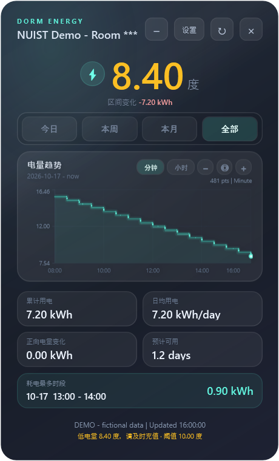
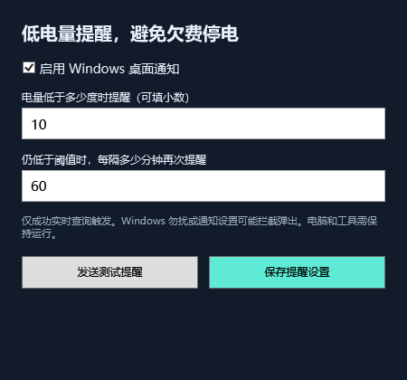
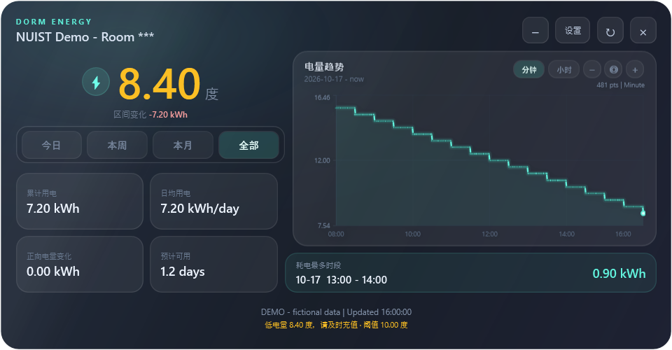

# 南京信息工程大学电费查询桌面工具（NUIST Electricity Query）

一个面向 Windows 的宿舍剩余电量桌面小工具。主要用途是定时查看剩余电量，在电量低于自设阈值时提醒及时前往官方入口充值，减少忘记缴费的情况；同时提供本地历史曲线、日 / 周 / 月统计，以及可折叠的玻璃风格窗口。

`v0.2.0` 新增 Windows 桌面低电量提醒：默认低于 **10 度**时提示，即使工具窗口隐藏或正在使用其他应用，也可通过系统托盘气泡提醒。提醒依赖电脑开机、工具运行、联网及有效授权，不能保证避免欠费停电。

本项目是非官方个人开源项目，与南京信息工程大学及相关服务运营方没有隶属或合作关系。它不附带有效登录凭据、个人房间配置或真实历史记录，不提供支付、充值或绕过登录的功能。学校页面和接口可能调整，当前方法不保证长期可用。

## 窗口效果

以下为真实 WPF 界面的演示截图：房间标识统一显示为 `Room ***`，电量、曲线和统计全部使用虚构数据，不包含个人宿舍或实际用电记录。

竖版窗口与低电量提醒设置：

<p>
  
  
</p>

横版布局：



折叠后保留电量和状态：


效果图可通过 `scripts/Export-Preview.ps1` 在本机重新生成；生成过程不读取个人配置、不访问学校接口，也不截取桌面或其他应用。

## 下载与启动

系统要求：Windows 10 / 11，系统自带的 Windows PowerShell 5.1 和 WPF。无需安装 Python、Node.js 或 GitHub 命令行工具。

1. 前往 [Releases](https://github.com/YONGZHEHAO/nuist-electricity-query/releases)，下载最新版本的便携 ZIP 并完整解压。
2. 双击 `NUIST-Electricity.exe`。这是无控制台启动器，请保留解压目录中的其他文件。
3. 点击工具中的“设置”，填写自己的房间显示名、查询参数和本人授权信息。首次使用请先阅读[配置与查询方法](docs/METHOD.md)。
4. 保存配置后刷新。授权有效、查询成功时，工具开始记录本机观测到的剩余电量，并检查低电量提醒条件。
5. 在“设置”的提醒设置区，或右键系统托盘图标单独打开“提醒设置”，调整开关、阈值和重复间隔。可点击“测试通知”检查当前 Windows 是否显示通知。

从旧版升级时，先关闭旧版工具，将新版 ZIP 完整解压到一个干净目录后运行。个人配置与历史保存在 `%LOCALAPPDATA%\NuistElectricityQuery\`，正常升级无需重新填写，也无需复制旧版程序目录中的数据。请勿同时运行两个版本。

只想体验界面，可在源码目录运行演示模式。演示数据完全虚构，不读取真实凭据、真实历史记录，也不发起网络请求：

```powershell
powershell.exe -NoProfile -STA -ExecutionPolicy Bypass -File .\src\PowerBalance.ps1 -Demo
```

## 功能与使用边界

- 默认每 60 秒查询一次；需要电脑开机、工具运行、网络正常且授权有效。
- 可设置的低电量桌面提醒：窗口状态区同步显示提示，系统托盘气泡可在窗口隐藏或使用其他应用时显示。
- 剩余电量曲线、本地历史记录、今日 / 本周 / 本月 / 全部区间，以及分钟 / 小时视图。
- 区间用电、正向电量变化、日均用电、预计可用时间和观测到的高耗电时段等参考统计。
- 窗口可拖动、从边缘及四角缩放；缩放时使用预览，结束后重新排布。
- 可折叠的桌面窗口和动态玻璃高光，展开时恢复原来的窗口尺寸。

### 低电量提醒规则

提醒默认启用，阈值默认 **10 度**，只有成功实时查询得到的电量**严格小于**阈值才触发；等于阈值不触发。阈值可设置为 `0–10000` 度，支持小数。默认每 `60` 分钟重复一次，可调整为 `1–1440` 分钟。

提醒状态按房间保存在本机，用于避免每次一分钟查询或重启后连续弹出相同提示。成功查询到电量恢复至阈值或以上时，会清除该次低电量状态；以后再次低于阈值，会立即重新提醒。查询失败时，上一次缓存读数不会被作为新的低电量查询结果触发通知。

Windows 的勿扰模式、通知权限或系统设置可能隐藏气泡。建议配置完成后使用“测试通知”，并定期查看官方电量；测试成功也不代表此后的每次通知一定可见。工具不会通过邮件、微信或第三方推送提醒，也不能在电脑关机、工具退出或授权过期时持续监测。

演示模式默认不自动发出低电量通知，仅点击“测试通知”时发出测试提示。

历史记录从成功查询后开始积累，无法补回工具未运行期间的逐分钟数据。学校数据自身也可能有延迟，60 秒查询不等于每分钟都有新的电表读数。

统计根据相邻观测值推算，长时间断档、充值和校方数据修正都会影响结果。正向电量变化不是支付成功凭证，也不代表人民币充值金额；预计可用时间和高耗电时段不是电表账单或结算依据。

授权过期时，请在学校官方页面重新完成本人登录，再通过设置更新授权。工具不会从微信目录、浏览器配置或其他应用中自动搜集登录信息。

## 隐私与数据

所有个人配置和历史记录均保存在当前 Windows 用户的 `%LOCALAPPDATA%\NuistElectricityQuery\` 下：

- `config.json`：房间显示名及查询参数，不包含明文授权请求头。房间标识仍属于个人信息，请不要公开。
- `credentials.dat`：使用 Windows DPAPI 加密保存授权请求头，绑定当前 Windows 用户。不要分享该文件，也不要将其作为跨电脑备份使用。
- 历史记录：按房间查询配置的哈希分别保存 `history.csv`，不同配置不会混入同一份记录。
- `reminders.json`：低电量提醒开关、阈值和重复间隔；各房间独立的 `reminder-state.json` 保存上次提醒状态，避免查询或重启后刷屏。

低电量通知正文只展示当前电量和提醒阈值，不包含房间、姓名或账号。电量本身仍可能显示在锁屏或系统通知区域，可通过 Windows 通知设置控制其可见范围。

工具通过当前学校查询接口发送所配置的授权与房间参数，不设置项目维护者的遥测、数据上传或账号同步服务。开源代码、发行包和演示模式不包含你的个人运行数据。

DPAPI 保护的是磁盘上的凭据文件；运行时请求必须使用解密后的授权信息。同一 Windows 用户下运行的恶意程序仍可能访问个人数据。详见[隐私说明](docs/PRIVACY.md)。

## 从源码构建

在 Windows PowerShell 中进入项目目录：

```powershell
powershell.exe -NoProfile -ExecutionPolicy Bypass -File .\scripts\Build.ps1
```

也可以直接运行桌面脚本：

```powershell
powershell.exe -NoProfile -STA -ExecutionPolicy Bypass -File .\src\PowerBalance.ps1
```

已完成本人配置时，可使用 `-Once` 做单次查询检查：

```powershell
powershell.exe -NoProfile -STA -ExecutionPolicy Bypass -File .\src\PowerBalance.ps1 -Once
```

主要文件：

```text
src/PowerBalance.ps1       桌面界面、查询和本地历史
src/PowerBalance.Motion.cs 窗口动画和运动辅助
src/Alerts.ps1             低电量提醒设置、状态和桌面通知
scripts/Build.ps1          Windows 便携版构建入口
docs/METHOD.md            本人授权信息的手动配置方法
docs/PRIVACY.md           本地存储和公开发布边界
SECURITY.md               安全问题报告说明
CHANGELOG.md              版本更新记录
```

## 反馈与贡献

欢迎提交兼容性修复、界面改进和不含个人数据的复现步骤。提交 Issue、截图或 Pull Request 前，请移除姓名、学号、房间信息、完整请求地址中的个人参数、Cookie、授权请求头及本地用户名。

请勿提交原始 HAR 文件、登录响应、真实历史 CSV、个人配置、日志或未脱敏的屏幕截图。可以使用 `-Demo` 生成演示界面。安全问题请参阅 [SECURITY.md](SECURITY.md)。

版本：`v0.2.0`，完整改动见 [更新记录](CHANGELOG.md)。代码按 [MIT License](LICENSE) 发布；许可不代表授予任何学校账号或服务接口的访问权限。
